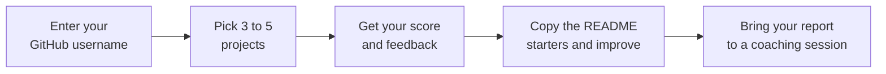

# 🔍 GitHub Portfolio Check

**Free, coaching-style feedback on how your GitHub profile looks to a recruiter.**

## Overview

Students often ask how to apply portfolio advice to their own GitHub, and whether their profile is ready to share with employers. This tool answers that in a few minutes. Enter your GitHub username, pick the projects you'd show a recruiter, and get a score out of 100 with specific, encouraging feedback on what to improve next.

The checks are based on the *Building a Technical Portfolio* guide.

## How It Works

## What It Checks

| Area | What a recruiter notices |
|:--|:--|
| 👤 **Profile setup** | A bio with your focus area, a professional username, a LinkedIn link, and a Profile README |
| 📁 **Project lineup** | At least three projects with READMEs a recruiter can follow |
| 📝 **READMEs** | Overview, Key Features, Tools and Technologies, Outcomes, How to Run, What I Learned, and a screenshot or demo |
| 🧹 **Organization** | Clear repository names, one-line descriptions, and no leftover test files |
| 📈 **Commit history** | Work pushed in small steps over time, not one big upload |

A few things GitHub doesn't share publicly, like pinned repositories and profile photo quality, are covered with quick yes or no questions.

## Feedback, Not Just a Score

Every item explains three things:

> **What we noticed** in your profile, using your actual repository names and files
> **Why it matters** to a recruiter
> **Try this:** one concrete next step

Each project also gets a **What's working** list next to its suggestions, plus a README starter you can copy and fill in.

## Good to Know

<b>Does it review my code?</b>

 
No. It looks at how your work is presented, not its technical quality. For technical questions, connect with your professors and your academic department.

<b>Is my information saved?</b>

 
No. Everything runs in your browser using GitHub's public data. Nothing is stored or sent anywhere.

<b>Why did I get a "try again later" message?</b>

 
GitHub limits how many lookups one network can make each hour. On shared campus Wi-Fi, switch to your phone's data or try again later.

## Built With

A single HTML file with no installation, no accounts, and no server.

---

Created by **Nydia Araya-Stivers, M.Ed.**, Professional Career Coach

